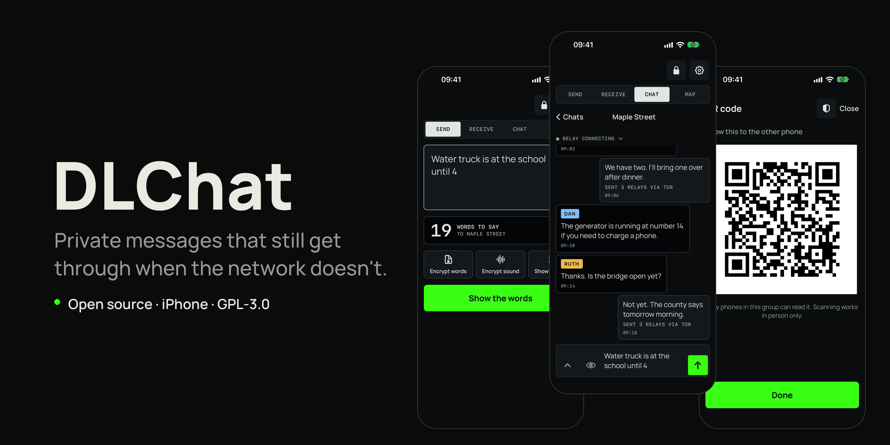
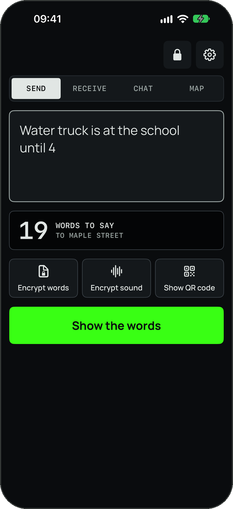
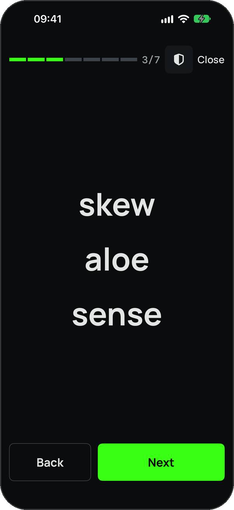
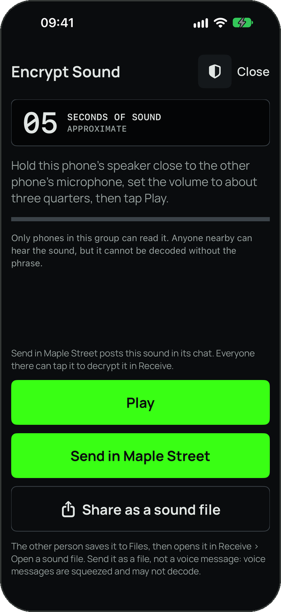
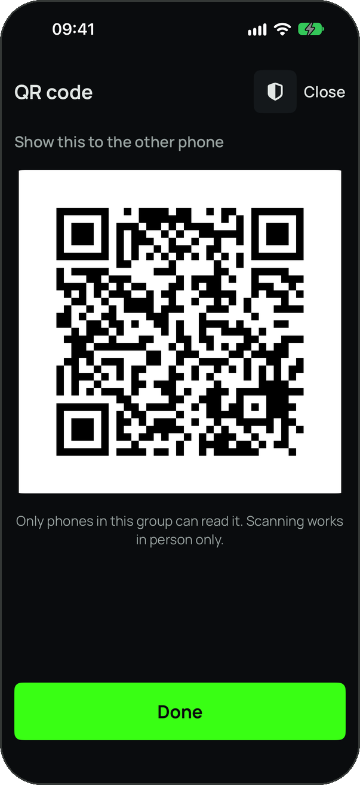
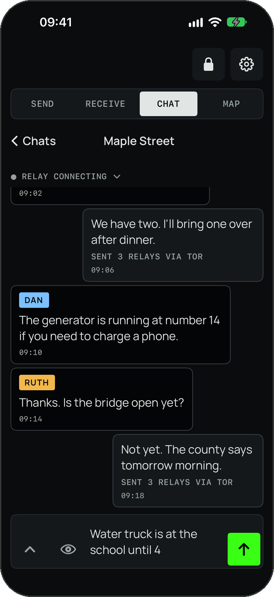
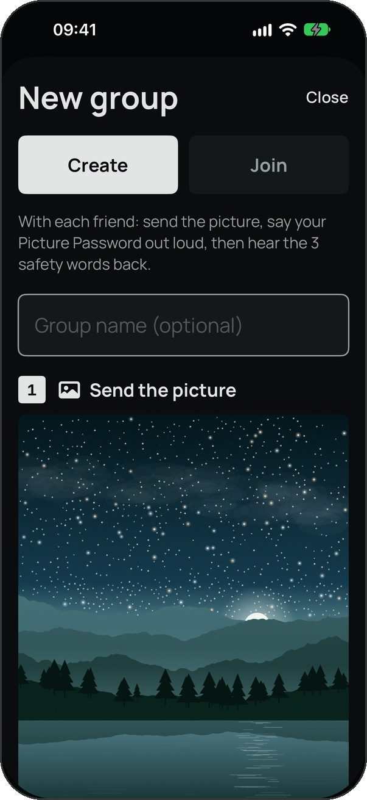
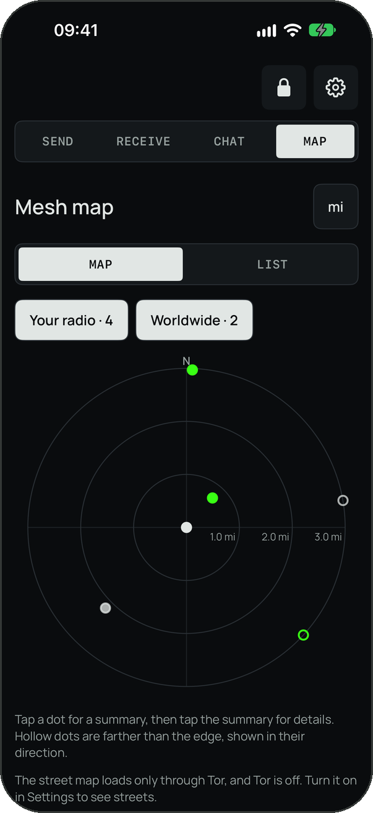
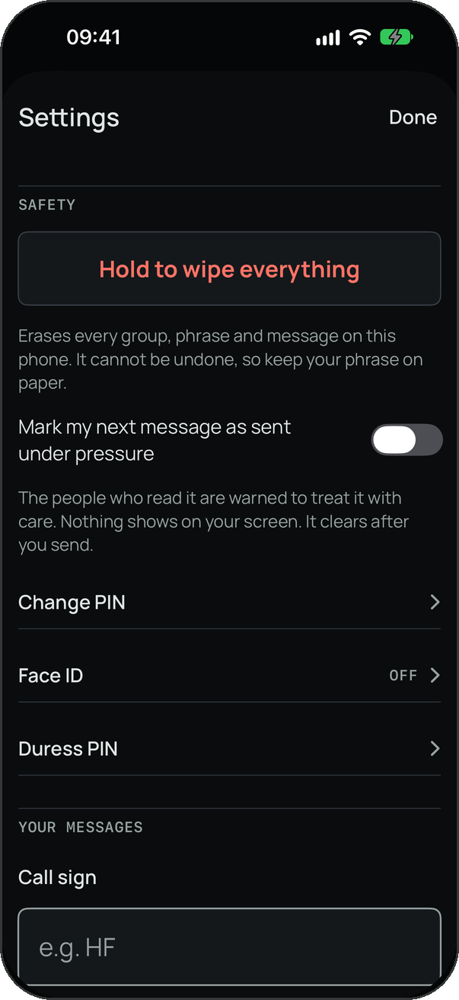

<p align="center">
  
</p>

<h1 align="center">DLChat</h1>

<p align="center">
  <strong>Private messages that still get through when the network doesn't.</strong><br>
  An open source iPhone app that seals a message, then lets you say it, play it, show it, or send it.
</p>

<p align="center">
  
  
  
  
</p>

---

## What it does

Your group shares a secret phrase of 10, 15 or 20 words that the app makes for you. Type a
message and DLChat seals it with that phrase. Then pick how it travels:

| | How | When it helps |
| --- | --- | --- |
| **Words** | The sealed message becomes a list of short, plain words to read aloud. | No data connection at all. Anyone listening hears gibberish. |
| **Sound** | The phone plays the message as tones and another phone listens. | Hands-free, phone to phone. |
| **QR code** | Show it to the person next to you. | Up close, no typing. |
| **Meshtastic** | Sent through your own Meshtastic radio, paired over Bluetooth. | Off-grid, over distance. |
| **Online** | Posted to public relays, through Tor by default. | When the internet works. |

Only a phone that holds the phrase can turn any of these back into your message.

## Screenshots

<p align="center">
  
  
  
  
</p>
<p align="center">
  
  
  
  
</p>

<p align="center"><sub>Every screen shows built-in demo content. No real people, messages or places.</sub></p>

## Features

**Group messages**
- A generated phrase of 10, 15 or 20 words is the only key. Share it in person, as a QR code, or
  hidden in a picture of a night sky that opens with a spoken password.
- One sealed message, five ways to carry it: words, sound, QR, Meshtastic, online relays.
- A mistyped or misheard word is caught and, where possible, repaired.

**Internet Messages**
- One-to-one chats with anyone who has DLChat. No phone number, no account.
- Post-quantum end-to-end encryption, sent only over Tor. There is no non-Tor mode.
- A fresh identity for every contact, so two contacts cannot tell they are talking to the same phone.

**Meshtastic**
- DLChat's own implementation of the Meshtastic phone protocol. Meshtastic is the only radio
  DLChat talks to.
- A mesh map with a radar and list of the radios your radio can hear.
- Off until you turn it on and accept its notice.

**Safety**
- A PIN lock, with optional Face ID.
- A duress PIN that erases everything and opens an app that looks normal and empty.
- Hold one button to wipe every group, phrase and message.
- Mark a message as sent under pressure, so the people who read it are warned.

**Privacy**
- No accounts, no analytics, no ads.
- Groups, phrases and messages stay on the phone unless you turn on online chat.
- Nothing reaches the developer unless you choose to send a bug report.

## Security

A plain description of what the code does, not a certification.

| | Group messages | Internet Messages |
| --- | --- | --- |
| **Key** | The shared phrase, stretched with PBKDF2-HMAC-SHA256 (600,000 rounds), then HKDF-SHA256 | Hybrid key agreement: X25519 together with ML-KEM-768 |
| **Sealing** | ChaCha20 with an HMAC-SHA256 tag, in a nonce-misuse-resistant (SIV) construction | Double Ratchet with ChaCha20-Poly1305, new keys every turn |
| **Forward secrecy** | No. The phrase is static | Yes |
| **Post-quantum** | Symmetric keys only | Yes, end to end. A phone that cannot do ML-KEM refuses rather than falling back |
| **Network** | None, your Meshtastic radio, or public relays (Tor on by default) | Tor only |

All of it uses Apple CryptoKit and CommonCrypto primitives. DLChat uses Tor as a client only, for
its own traffic: your online chats, Internet Messages, map tiles and any bug report you choose to
send. It does not run a Tor relay.

**What DLChat does not protect**
- Anyone who gets your group phrase can read every message in that group, past and future.
- People nearby can tell that you are sending something, when, and roughly how long it is.
- The app PIN guards the screen. It adds no encryption.
- **No independent cryptographer has reviewed the design yet.** Do not rely on DLChat where your
  safety depends on it.

More detail: [`SECURITY_REVIEW.md`](SECURITY_REVIEW.md), [`docs/data-inventory.md`](docs/data-inventory.md)
(everything the app stores or sends, and where it goes) and
[`docs/design/internet-messages.md`](docs/design/internet-messages.md).

## Status

Beta, version 1.1, distributed through TestFlight. Not on the App Store. The legal questions about
sending encrypted traffic over radio are still open (see
[`docs/launch-blockers.md`](docs/launch-blockers.md)).

## Building

You need a Mac with a current Xcode. The app runs on iOS 17 and later; Internet Messages need
iOS 26 or later.

```sh
git clone https://github.com/rarecreaturesllc/dlchat-open.git
cd dlchat-open
sh scripts/fetch-tor.sh                      # once after cloning (Tor is fetched and checksum-verified, not committed)
swift test --package-path Packages/DLCore    # core tests
open DLChat.xcodeproj                         # build and run the DLChat scheme
```

To run on your own iPhone, set your own team and bundle identifier under Signing & Capabilities.

| Path | What is there |
| --- | --- |
| `Packages/DLCore` | The core: phrase, keys, sealing, word and tone codecs, Meshtastic protocol, Internet Messages |
| `DLChat` | The SwiftUI app |
| `Packages/TorKit` | The Tor wrapper |
| `relay` | The small Go relay behind Internet Messages' private route |
| `docs` | Design notes, data inventory, licenses, open launch blockers |

## Use at your own risk

DLChat is free, open source software provided **"as is", without warranty of any kind**, to the
extent permitted by law (see sections 15 and 16 of the license). You use it entirely at your own
risk.

**Radio rules are your responsibility.** The Meshtastic radio feature is off until you turn it on
and accept its notice. By turning it on, you confirm you will use a radio and region setting that
are allowed where you are, and that you alone are responsible for what your radio transmits.
DLChat will not send while the radio is set to licensed mode. If you choose to use DLChat together
with any radio equipment, you are responsible for following the laws and license conditions for
that equipment and band.

## License

Copyright (C) 2026 Rare Creatures LLC. DLChat is developed and published by Rare Creatures LLC.

This program is free software: you can redistribute it and/or modify it under the terms of the
GNU General Public License as published by the Free Software Foundation, either version 3 of the
License, or (at your option) any later version. This program is distributed in the hope that it
will be useful, but WITHOUT ANY WARRANTY; without even the implied warranty of MERCHANTABILITY or
FITNESS FOR A PARTICULAR PURPOSE. See the full text in [`LICENSE`](LICENSE).

Third-party components keep their own licenses (MIT, BSD, Apache 2.0, SIL OFL, CC BY); see
[`docs/asset-licenses.md`](docs/asset-licenses.md).
